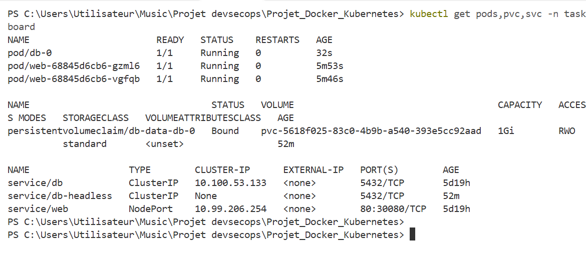
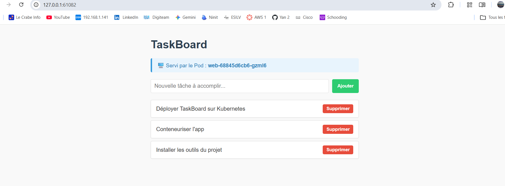
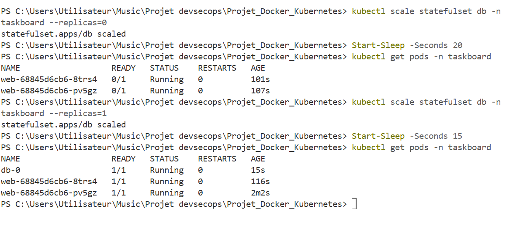
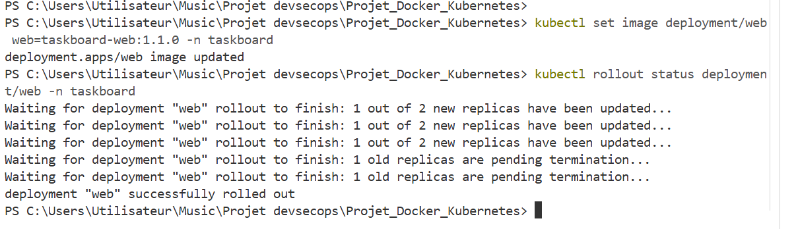

# TaskBoard — Déploiement Docker & Kubernetes

Application web de gestion de tâches (**TaskBoard**) développée en Node.js / Express avec une base de données PostgreSQL, conteneurisée avec Docker et orchestrée sur Kubernetes (Minikube).

## Architecture

- **Application Web (`app/`)** : API REST (`/api/tasks`, `/api/hostname`) et interface web, exposée sur le port `3000`.
  - `/healthz` : sonde de vivacité (*livenessProbe*), renvoie `200 OK` tant que le processus tourne.
  - `/readyz` : sonde de disponibilité (*readinessProbe*), teste la connexion PostgreSQL (`200 OK` ou `503 Service Unavailable`).
- **Base de données** : PostgreSQL déployé en `StatefulSet` (`db-0`) avec stockage persistant (`PersistentVolumeClaim` de `1Gi`) et accès interne via Service `ClusterIP` (`db:5432`).
- **Exposition** : `Deployment` de 2 réplicas `web` exposé via un Service `NodePort` (`80:30080`).

---

## Prérequis

- Docker Desktop
- Minikube & `kubectl`

---

## Lancement local (Docker Compose)

```bash
docker compose up --build
```

L'application est accessible sur `http://localhost:3000`. Pour tout arrêter et nettoyer les volumes :

```bash
docker compose down -v
```

---

## Déploiement sur Kubernetes (Minikube)

### 1. Démarrer Minikube et créer le namespace

```bash
minikube start
kubectl apply -f k8s/00-namespace.yaml
```

### 2. Créer le Secret PostgreSQL

Chacun choisit son mot de passe pour son Minikube local. Le fichier `k8s/11-secret.example.yaml` sert de modèle avec la valeur fictive `A_REMPLACER`.

Enregistrer le mot de passe de développement dans un fichier texte hors du dépôt, sans retour à la ligne final. Remplacer `CHEMIN_VERS_LE_FICHIER` par le chemin de ce fichier. Avec `--from-file`, `kubectl` lit le contenu du fichier et le range sous la clé `DB_PASSWORD` (le mot de passe reste ainsi hors de l'historique de commandes) :

```bash
kubectl create secret generic db-credentials --namespace taskboard --from-file="DB_PASSWORD=CHEMIN_VERS_LE_FICHIER"
```

Vérifier que le Secret contient la bonne clé sans afficher sa valeur :

```bash
kubectl describe secret db-credentials --namespace taskboard
```

Le Secret est de type `Opaque`. La section `Data` affiche `DB_PASSWORD` et sa taille en octets.

### 3. Construire et charger l'image dans Minikube

```bash
docker build -t taskboard-web:1.0.0 ./app
minikube image load taskboard-web:1.0.0
```

### 4. Appliquer les manifestes Kubernetes

```bash
kubectl apply -f k8s/10-configmap.yaml
kubectl apply -f k8s/20-db-service.yaml
kubectl apply -f k8s/21-db-statefulset.yaml
kubectl apply -f k8s/30-web-deployment.yaml
kubectl apply -f k8s/31-web-service.yaml
```

Vérifier l'état du cluster et ouvrir l'application :

```bash
kubectl get pods,pvc,svc -n taskboard
minikube service web -n taskboard
```

---

## Validation et captures d'écran

### État du cluster déployé (`db-0`, 2 réplicas `web`, PVC `Bound`, `NodePort 30080`)


### Interface TaskBoard (`v1.0.0`) avec affichage du Pod serveur


### Test T6 — Coupure PostgreSQL sans redémarrage des Pods web
Lorsque `db` est ramené à `0` réplica, la `readinessProbe` (`/readyz`) fait passer les 2 Pods `web` en `0/1 Running` avec **`RESTARTS: 0`**. Dès le retour de `db-0`, ils repassent automatiquement en `1/1 Running`.


### Test T9 — Mise à jour sans coupure (Rolling Update `1.0.0` → `1.1.0`) et Rollback
```bash
kubectl set image deployment/web web=taskboard-web:1.1.0 -n taskboard
kubectl rollout status deployment/web -n taskboard
kubectl rollout undo deployment/web -n taskboard
```
